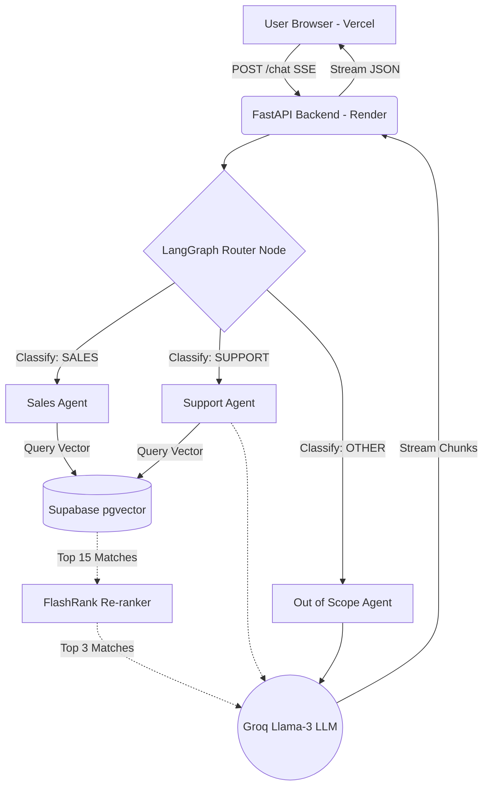

# NexusAI — Enterprise Agentic Fashion Assistant 🚀

<div align="center">


[](https://nextjs.org/)
[](https://fastapi.tiangolo.com/)
[](https://langchain-ai.github.io/langgraph/)
[](https://groq.com/)
[](https://supabase.com/)
[](https://nexus-ai-fashion-assistant.vercel.app/)
[](https://render.com)

**A production-ready, intelligent retail assistant demonstrating the future of e-commerce. Powered by LangGraph agentic routing, advanced RAG (Retrieval-Augmented Generation) with semantic vector search, and Groq's lightning-fast inference.**

[**🔴 Live Vercel Demo**](https://nexus-ai-fashion-assistant.vercel.app/) · [**Report a Bug**](https://github.com/juni2003/NexusAI-Fashion-Assistant/issues)

</div>

---

## 🌟 The Vision: Why NexusAI?

Modern e-commerce requires more than just keyword search—it demands intelligent, context-aware conversational agents. **NexusAI** bridges the gap between a personal shopper and a customer support representative. 

Instead of relying on rigid decision trees, NexusAI utilizes an **Agentic AI architecture** capable of understanding user intent, performing semantic database searches, reranking results for maximum relevance, and streaming personalized responses in real-time.

## 🏗️ Enterprise Architecture & Tech Stack

NexusAI is built on a highly decoupled, modern microservices architecture optimized for speed, scalability, and zero-hallucination AI responses.

### 1. The Brain: Agentic AI Workflow (LangGraph & Groq)
- **LangGraph Routing:** Every incoming message passes through a deterministic router node. The agent autonomously classifies the intent into `SALES`, `SUPPORT`, or `OUT_OF_SCOPE`, ensuring the LLM only uses the exact tools and context required for that specific query.
- **Groq Llama-3 Inference:** Replaces traditional slow LLM endpoints with Groq's LPU (Language Processing Unit), achieving sub-second token generation for a fluid, real-time user experience.
- **Conversation Memory:** Context window injection ensures the agent remembers the last 5 conversation turns, allowing for natural, human-like follow-up questions.

### 2. The Memory: Vector Retrieval & Re-ranking (Supabase pgvector)
- **Semantic Product Search:** Over 300 real fashion products are embedded into a high-dimensional vector space using local `sentence-transformers` (`all-MiniLM-L6-v2`).
- **Supabase pgvector:** Cloud-hosted PostgreSQL handles the vector similarity search (cosine similarity), matching user intent to product meanings rather than exact keyword matches.
- **FlashRank Re-ranking:** A crucial enterprise addition. We fetch the top 15 results from Supabase, but use an in-process FlashRank cross-encoder to re-rank and extract the absolute top 3 most relevant products before sending them to the LLM.

### 3. The Interface: Real-time Frontend (Next.js & Vercel)
- **Next.js 15 (App Router):** Provides robust Server-Side Rendering (SSR) and seamless API route handling.
- **Server-Sent Events (SSE):** Consumes the FastAPI backend stream to render the LLM's response token-by-token (ChatGPT style).
- **Glassmorphic UI:** Built with Tailwind CSS and Framer Motion for a premium, dark-mode aesthetic featuring micro-animations and responsive product cards.
- **Edge Image Proxying:** A custom Next.js API route transparently proxies external CDN images to bypass strict CORS and hotlinking protections.

### 4. The Engine: Scalable Backend (FastAPI & Render)
- **FastAPI / Uvicorn:** A high-performance Python web framework handling concurrent async SSE streams.
- **Render Web Services:** The backend is deployed as a robust web service, automatically building and scaling the Python environment upon every GitHub commit.

---

## 🔄 System Flow Diagram



---

## 🛠️ Local Setup & Development

### Prerequisites
- Node.js 18+, Python 3.11+
- A [Supabase](https://supabase.com) project with `pgvector` extension enabled
- A [Groq API Key](https://console.groq.com/)

### 1. Clone & Set Up Backend
```bash
git clone https://github.com/juni2003/NexusAI-Fashion-Assistant.git
cd NexusAI-Fashion-Assistant/backend

# Create and activate virtual environment
python -m venv venv
source venv/bin/activate      # Linux/Mac
.\venv\Scripts\activate       # Windows

# Install dependencies
pip install -r requirements.txt

# Configure Secrets
cp .env.example .env
# Edit .env with your GROQ_API_KEY, SUPABASE_URL, and SUPABASE_KEY

# Launch the API
uvicorn main:app --reload --port 8000
```
*API documentation automatically generated at `http://localhost:8000/docs`*

### 2. Set Up Frontend
```bash
cd ../frontend
npm install

# Connect frontend to local backend
echo "NEXT_PUBLIC_API_URL=http://127.0.0.1:8000" > .env.local

# Launch Next.js
npm run dev
```
*Application live at `http://localhost:3000`*

---

## 🚀 Deployment Guides

### Deploy Backend to Render (Python Environment)
1. In [Render](https://render.com), create a new **Web Service**.
2. Connect this GitHub repository.
3. Configuration:
   - **Root Directory:** `backend`
   - **Environment:** `Python 3`
   - **Build Command:** `pip install -r requirements.txt`
   - **Start Command:** `uvicorn main:app --host 0.0.0.0 --port $PORT`
4. Add Environment Variables: `GROQ_API_KEY`, `SUPABASE_URL`, `SUPABASE_KEY`, and `PYTHON_VERSION=3.11.0`.

### Deploy Frontend to Vercel
1. In [Vercel](https://vercel.com), add a **New Project** and import this repository.
2. Configuration:
   - **Root Directory:** `frontend`
   - **Framework Preset:** `Next.js`
3. Add Environment Variables:
   - `NEXT_PUBLIC_API_URL`: Your live Render backend URL (e.g., `https://nexusai-backend.onrender.com`).
4. Click **Deploy**.

---

## 👨‍💻 Author & License
Designed and developed to showcase modern Agentic AI workflows in e-commerce.

This project is open-source and available under the [MIT License](LICENSE).
